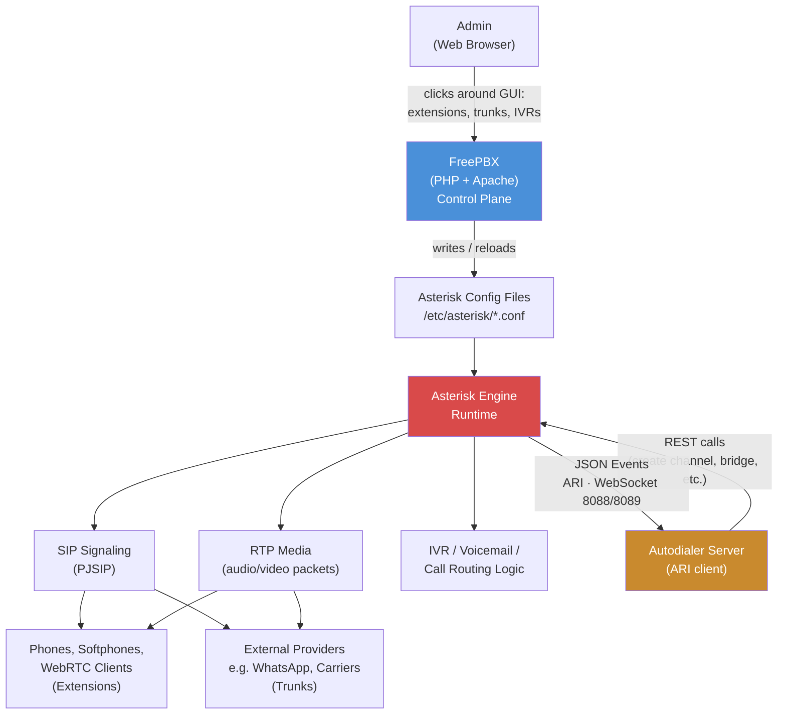

# FreePBX + Asterisk VoIP Preparation Reading file.

## 1. Onboarding to Domain

**SIP (Session Initiation Protocol)** — the "control plane" protocol for VoIP. Think of it like HTTP for calls: it's a text-based protocol (looks like HTTP headers) used to negotiate "I want to call this address" — INVITE, RINGING, OK, BYE. It sets up a call but carries none of the actual audio.

**RTP (Real-time Transport Protocol)** — the "data plane." Once SIP negotiates a call, the actual audio/video packets flow over RTP, UDP-based, one stream per direction per call. This is why VoIP needs a wide range of UDP ports open (10000–20000 here) — each concurrent call needs its own port pair, unlike HTTP where everything multiplexes over 443.

**Codec** — how audio is encoded onto the wire (like a serialization format for audio). Opus is a modern, high-quality, low-bitrate codec — this repo compiles it in specifically because WebRTC and WhatsApp calling require it (older Asterisk installs only ship G.711/G.729).

**Asterisk** — the actual telephony engine/server. It's the "runtime" — it handles SIP signaling, RTP media, IVR logic, voicemail, call routing. It's configured via plain text config files (`/etc/asterisk/*.conf`) and controlled via a CLI (`asterisk -rx "command"`), similar in spirit to how you'd `redis-cli` into Redis.

**FreePBX** — a PHP/Apache web app (a "control plane UI + config generator") that sits on top of Asterisk. You click around a web GUI (extensions, trunks, IVRs, queues) and FreePBX writes out the Asterisk `.conf` files and reloads it. Analogy: Asterisk is like raw nginx config; FreePBX is like a CMS that generates nginx config for you. This distinction matters a lot for contributing — bugs are either "Asterisk isn't doing the right thing at the SIP/RTP layer" or "FreePBX generated the wrong config / has a UI/module bug."

**PJSIP** — the modern SIP stack/channel driver inside Asterisk (replaced the older `chan_sip`). When you see "PJSIP trunk," "PJSIP TLS," that's what's being configured.

**Trunk vs Extension** — an extension is an internal endpoint (a phone/softphone/WebRTC client registers to it). A trunk is a connection to an external SIP provider (e.g., Meta's WhatsApp SIP endpoint, or a carrier) that lets calls in/out of the PBX.

- A SIP trunk is one type of trunk — specifically one that uses the SIP protocol to hand off calls to a carrier or ITSP (Internet Telephony Service Provider) instead of a physical PSTN line. Concretely, one SIP trunk can carry many simultaneous calls (limited by your provider's "channel" limit), whereas an old-school analog line only handled one call at a time.
- Typical flow:
    - Someone dials your business number from a regular phone.
    - The call hits your SIP trunk provider (e.g., Twilio, Telnyx, a local carrier STC, We, Vodafone).
    - The provider forwards it over SIP/RTP to your PBX.
    - Your PBX routes it to an extension, IVR, ring group, etc.
    - outbound is the reverse — your PBX sends the call out through the trunk to the provider, who connects it to the PSTN.

**WebRTC here** — browsers have no access to raw TCP/UDP sockets for security, so JavaScript can't speak plain SIP (register as phone). Instead, FreePBX wraps SIP inside WebSocket messages on ports 8088/8089, which browsers allow. Libraries like JsSIP handle the wrapping/unwrapping in JavaScript. RTP audio still flows directly over UDP (10000–20000), so only signaling goes through WebSocket. For production, use WSS (TLS-encrypted) on port 8089.

---

## 2. Understanding the Environment — The VoIP Ecosystem

### FreePBX ↔ Asterisk, in Practice

Section 1 explained the two roles in theory. Here's what actually happens, end to end, when you click "Save" in the FreePBX GUI and then place a call:



**Reading it:**
- **You never talk to Asterisk directly.** FreePBX is the layer you click around in — it's a config generator, not the thing making calls.
- **FreePBX's only real job is writing files.** Every GUI action (new extension, new trunk, new IVR) ends with FreePBX rewriting Asterisk's `.conf` files and telling it to reload.
- **Asterisk is where calls actually happen.** Once configured, Asterisk handles SIP signaling and RTP media on its own — FreePBX isn't in the call path at all.
- **This is why bugs split into two buckets:** if a call won't connect or has no audio, that's an Asterisk/SIP/RTP problem. If a setting won't save or the GUI shows the wrong thing, that's a FreePBX problem.

### Talking to Asterisk From the Autodialer

**ARI — Asterisk RESTful Interface**
- ARI exposes Asterisk's raw building blocks directly — **channels, bridges, endpoints, media** — as REST resources, so you build your own call-control app instead of just triggering existing dialplan logic.
- REST calls in (HTTP), state changes out as **JSON events over a WebSocket** — using normal REST + JSON.
- This is the right tool when your app *is* the call logic (e.g. an autodialer deciding who to call, when, and what to do next), rather than just watching/nudging calls Asterisk is already handling.
- Runs over Asterisk's built-in HTTP server — same one used for WebRTC — configured in `ari.conf` / `http.conf`.
- **Postman collection:** [Bevatel Dev — ARI collection](https://bevatel-dev.postman.co/workspace/Team-Workspace~b7b81c0f-920e-4f74-8132-1650596fab03/collection/57597740-98b668f3-60a3-4611-a278-79d452d68cff?action=share&source=copy-link&creator=57597740) *(internal — request access if you can't open it)*, or check the copy kept in the repo.

### Ports

* `80/443` – web GUI (HTTP/HTTPS), in case you are going to use it on a VPS or container
* `5060` – SIP protocol and softphone connections
* `8088/8089` – WebRTC WebSocket (WS/WSS) — also serves ARI (REST + WebSocket) for the autodialer
* `50633` – PJSIP TLS (WhatsApp, talks to Meta's port 5061)
* `10000–20000/udp` – RTP media, handled via auto-configured iptables rules (works around a known Docker large-port-range limitation)

### Host Requirements

* Needs `ip`, `iptables`, `awk`, `docker`, `docker-compose`
* Docker iptables rules bypass the host firewall, so `iptables-persistent` is auto-installed for rule persistence
* Requires valid DNS in Docker's daemon config
* Fail2ban default: bans after 2 failed SIP attempts in 30 seconds, for 1 week

---

## 3. Getting Started

### Installation

**1. Create credential files** (MySQL root, FreePBX DB user, Postfix SMTP), then lock them down:

```bash
# MySQL root password
printf "yourStrongPassword" > mysql_root_password.txt

# FreePBX database user password
printf "yourStrongPassword" > freepbxuser_password.txt

# Postfix SMTP credentials (even if not using email notifications)
printf "[smtp.gmail.com]:587 your-email@gmail.com:yourAppPassword" > sasl_passwd.txt

# Secure the files
chmod 600 mysql_root_password.txt freepbxuser_password.txt sasl_passwd.txt
```

**2.** Optionally configure Postfix relay host

**3.** Edit `docker-compose.yml` (hostname, network, volume paths)

**4. Run the install script** — builds the image, sets iptables, starts containers, installs FreePBX with 11 core modules, configures SSL and Opus:

> **Note:** if you're on a company network, connect your VPN *before* running the install script — corporate firewalls/proxies can block the Docker image build or package downloads mid-install.

```bash
# Simple one-command installation
sudo bash run.sh

# Custom RTP port range (optional)
sudo bash run.sh --rtp 16384-32767
```

**5.** Access the web GUI via server IP (HTTP/HTTPS) and complete setup

**Connecting to Asterisk** — `run.sh` enables ARI and creates a `dev` user (it prints how to read the password):
- ARI: `http://<host>:8088/ari` (HTTPS `8089`)
- CLI: `docker compose exec freepbx asterisk -rvvv`
- SIP traces: `sudo sngrep -d freepbxint` (or `-d any` to include trunk traffic)

> Never recreate the `freepbx` container (`docker compose up --force-recreate`, changing ports in compose): FreePBX is installed inside it, not in the image, so it would be wiped.

**TLS/Certificates** — Needed for WebRTC and WhatsApp. Use FreePBX's Certificate Management to get Let's Encrypt (recommended) or upload a custom cert, then assign it under Asterisk SIP Settings and set the TLS Bind Port to 50633.

**WhatsApp Setup** — Needs a valid cert, a WhatsApp Business Account with API access, Meta business verification, and a PJSIP trunk pointed at Meta's SIP endpoint; port 50633 must be reachable from Meta's servers.

**WebRTC Setup** — Install a cert, confirm ports 8088/8089 are configured, enable WSS transports in PJSIP settings, then create WebRTC-enabled extensions and test via the User Control Panel (UCP).

**Maintenance Commands** — Standard `docker compose` commands (status, logs, restart, stop), plus a `--clean-all` wipe option, an Opus codec check, and iptables inspection commands.

**Storage** — Persistent data lives under `/mnt/storage/` (conf, log, recording, agi-bin, database).


**6. Testing Your Setup with a Softphone (Linphone)** — Once an extension exists, the fastest way to confirm the whole stack (extension config → SIP registration → RTP audio) actually works end to end is to register a desktop/mobile softphone against it:

  1. **Create a PJSIP extension** — Applications > Extensions > Add Extension > "PJSIP Extension." Set an extension number (e.g. `1001`) and a secret (password), then Save and Apply Config.
  2. **Note the connection details** — server IP/hostname, extension number (SIP username), secret, and port (`5060` for plain SIP, or `50633` for TLS).
  3. **Install Linphone** — download the desktop or mobile build from [linphone.org/download](https://www.linphone.org/en/download/) for your OS.
  4. **Add the SIP account** — Linphone > Settings/Preferences > SIP Accounts > Add Account > "Use SIP Account." Username = extension number, Password = secret, Domain = server IP/hostname, Transport = UDP (5060) or TLS (50633).
  5. **Confirm registration** — a green/registered status next to the account name means the extension authenticated successfully against Asterisk.
  6. **Place a test call** — call between two extensions/devices, or dial Asterisk's built-in echo test (usually `*43`, if enabled) to confirm two-way RTP audio.
  7. **If it fails** — no registration means a blocked/unreachable port (5060 or 50633); registers but no audio means the RTP port range (10000–20000/udp) isn't open; TLS errors mean the cert isn't assigned under Asterisk SIP Settings.

## Resources
- [read me from original auther](./README-from--original-auther.md)
- [original repo](https://github.com/ekoyuliawan/freepbx-docker)
- [FreePBX Distro it's Asterisk + FreePBX + OS all in one](https://sangomakb.atlassian.net/wiki/spaces/FP/pages/713326867/FreePBX+Open+Source+-+Install+v17+with+ISO+Distro)
- [asterisk](https://docs.asterisk.org/)
